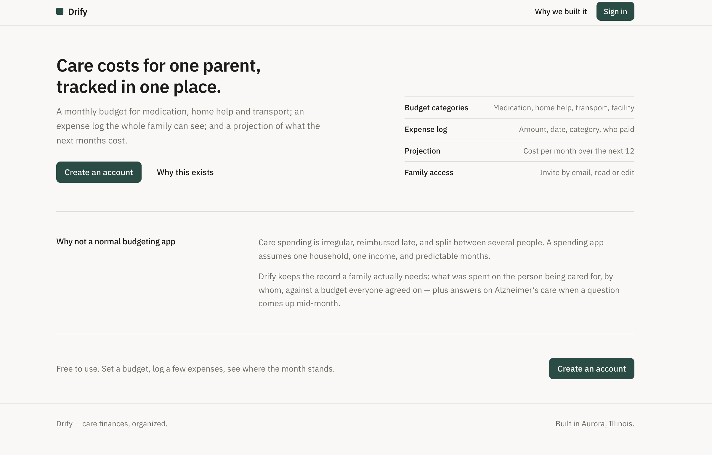
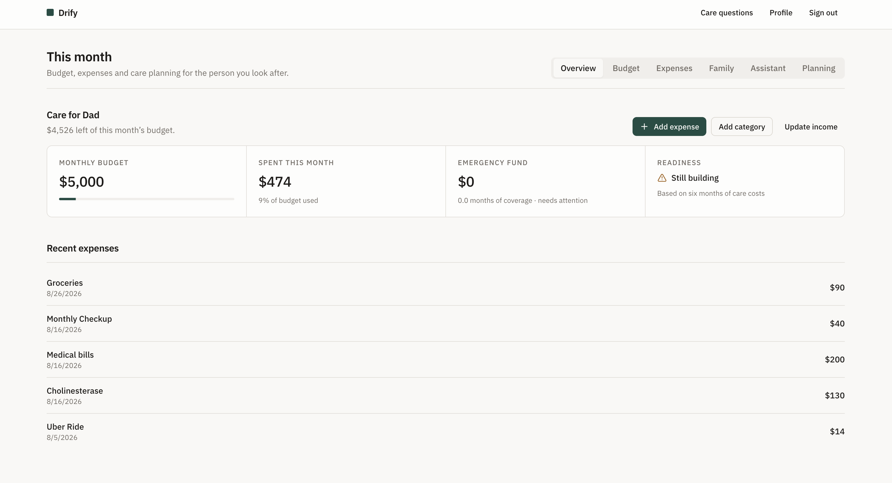
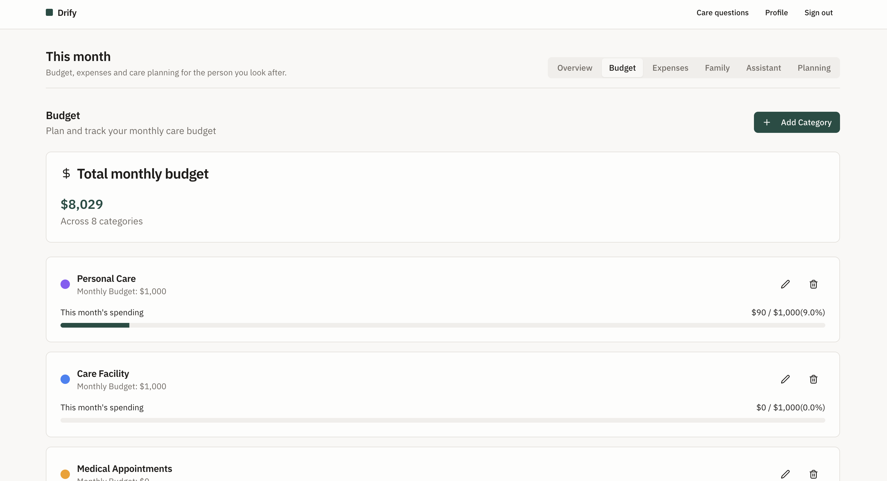
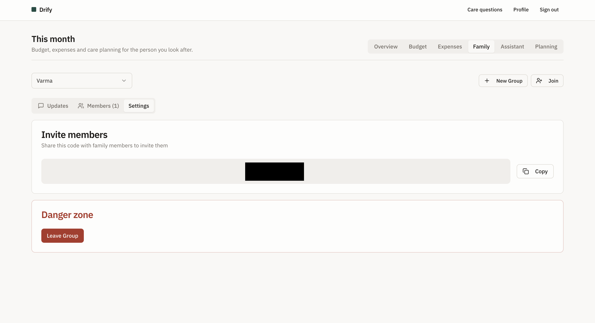
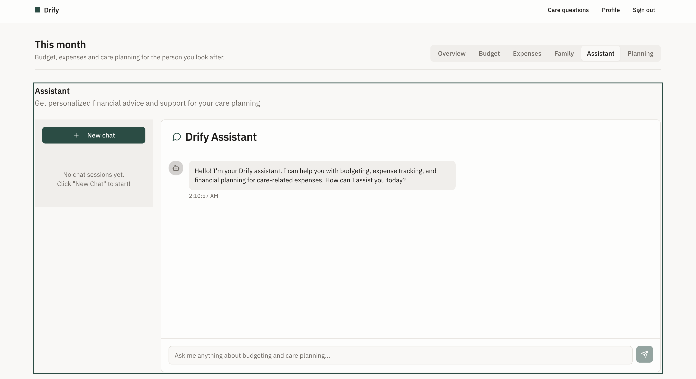
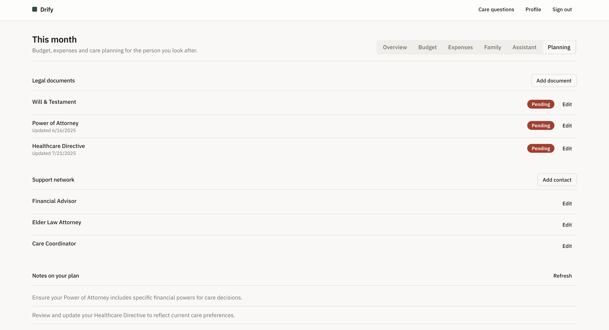
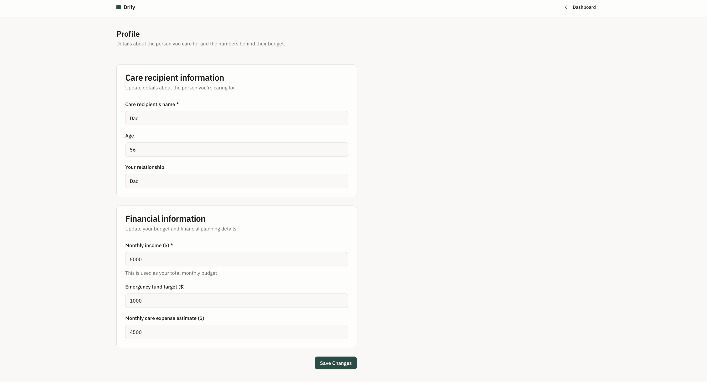
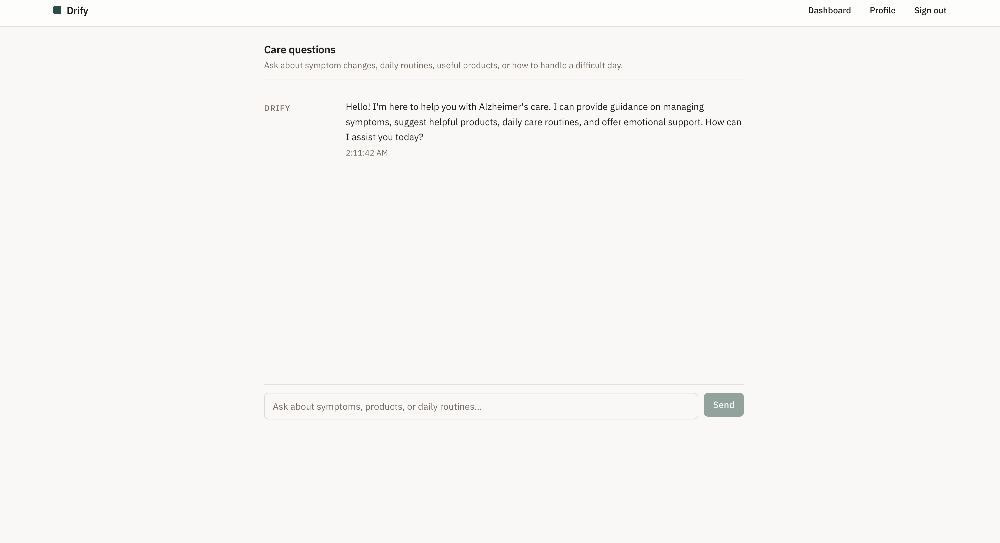

# Drify

Drify is a care-finance organizer built for families supporting a parent or loved one with chronic conditions such as Alzheimer's.

It helps you track monthly care budgets, log expenses, collaborate with family members, and ask care-related questions in one place.

## Purpose

Most budgeting apps assume one household and predictable spending. Caregiving expenses are different: they are irregular, shared by multiple people, and often tied to urgent medical needs.

Drify exists to make that process manageable by giving families a shared system for:

- Tracking care-specific spending by category
- Understanding monthly budget progress
- Coordinating as a family group
- Keeping planning notes and legal/support contacts together
- Getting quick guidance through an assistant experience

## Core Features

- Authentication and profile setup with Supabase
- Monthly dashboard with budget summary, spend, and readiness indicators
- Budget category management with per-category progress
- Expense tracking and recent activity feed
- Family collaboration with group invite flow
- Planning workspace for legal documents, support network, and notes
- Care question assistant and in-dashboard assistant chat views

## Screenshots

### 1) Landing page



### 2) Dashboard overview



### 3) Budget management



### 4) Family collaboration settings



### 5) In-dashboard assistant



### 6) Profile and financial setup



### 7) Planning tools



### 8) Care questions page



## Tech Stack

- React + TypeScript
- Vite
- Tailwind CSS
- shadcn/ui
- Supabase (auth, database, edge functions)

## Local Development

1. Clone the repo.
2. Install dependencies.
3. Start the dev server.

```sh
git clone <your-repo-url>
cd drify
npm install
npm run dev
```

## Environment Variables

Create a local `.env` file using `.env.example` and provide your Supabase project values.

```env
VITE_SUPABASE_PROJECT_ID=...
VITE_SUPABASE_PUBLISHABLE_KEY=...
VITE_SUPABASE_URL=...
```

Do not commit `.env`.
